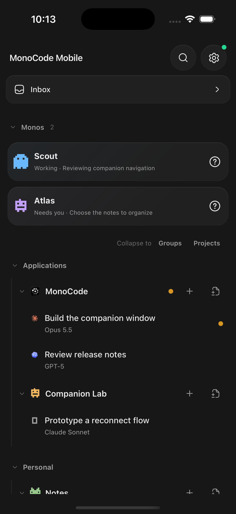
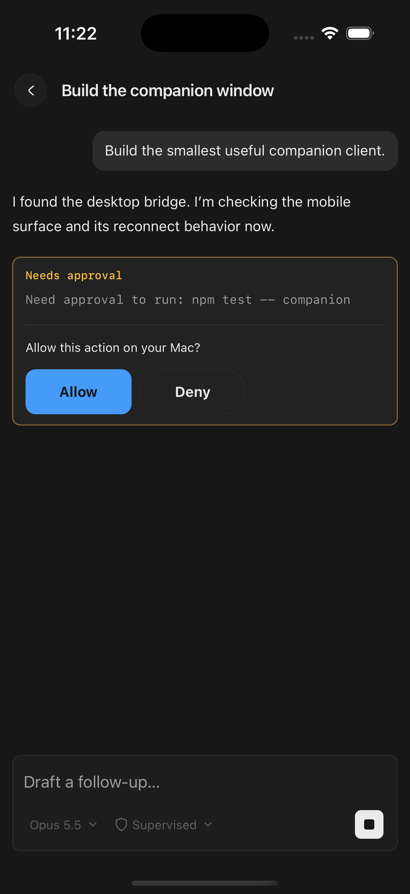
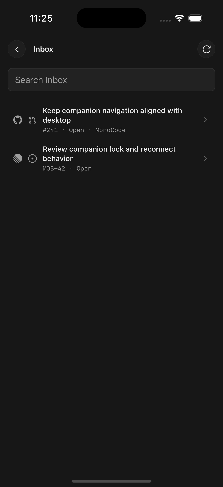
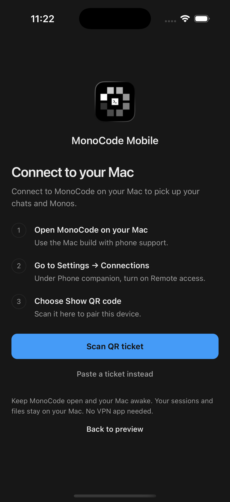
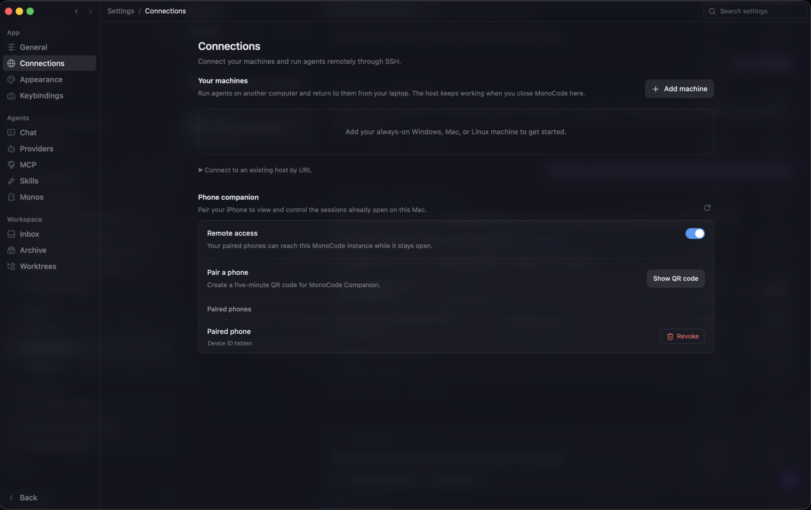
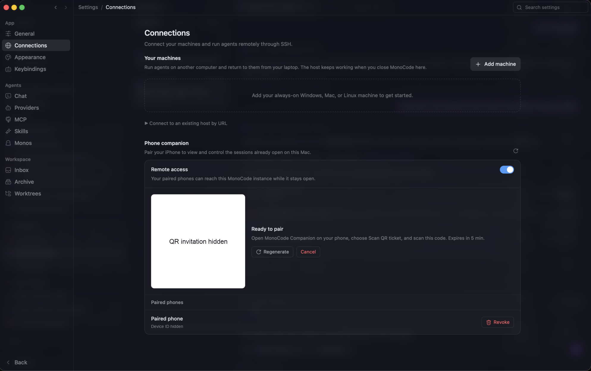

<p align="center">
  
</p>

<h1 align="center">MonoCode Mobile Companion</h1>

<p align="center">
  <strong>Continue your Mac coding-agent sessions from your iPhone.</strong>
</p>

An experimental iPhone companion for [MonoCode](https://github.com/hardbeat920/monocode). Follow an agent's tool activity, send a follow-up, answer questions and approval prompts, review recorded file changes, or stop a turn while away from your desk. The phone controls the same sessions already running on your Mac; agent processes, provider credentials, project files, and authoritative conversation history remain on the Mac.

**Development prototype:** this fork includes a modified Mac host and a native Tauri iOS client. It is an independent experiment, not an official MonoCode mobile release. The unmodified upstream desktop app cannot host this companion. Building for a physical iPhone requires Xcode and Apple development signing; no App Store or TestFlight release is available.

**Current source preview: Companion 0.1.1 · MonoCode desktop base 0.13.0.**
The [automatic-update and distribution plan](docs/companion/updates-and-distribution.md)
describes direct signed Mac downloads, in-app updates and TestFlight without a
public App Store listing. These distribution channels are not live yet. Maintainers
can follow the [release setup checklist](docs/companion/release-setup.md).

## Screenshots

### iPhone interface

These are unedited device-screen captures from the iPhone Simulator on iOS 18.6, using the companion's sample workspace. No live conversations, provider accounts, or pairing tickets are shown.

<table>
  <tr>
    <th>Workspace and Monos</th>
    <th>Chat and action approvals</th>
  </tr>
  <tr>
    <td></td>
    <td></td>
  </tr>
  <tr>
    <th>Read-only Inbox</th>
    <th>QR pairing setup</th>
  </tr>
  <tr>
    <td></td>
    <td></td>
  </tr>
</table>

### Pairing on the Mac

Open **Settings → Connections → Phone companion** to enable remote access, create a QR invitation, and manage paired phones. These Mac screenshots have opaque masks over the QR invitation and device ID; all other pixels are unchanged.

**Remote access and paired-phone management**

<p align="center">
  
</p>

**QR invitation ready to scan from the iPhone**

<p align="center">
  
</p>

## What the companion supports

- Browse groups, projects, sessions, and Monos, with appearance inherited from the Mac.
- Read transcripts, send follow-ups, create sessions, and select available models and access modes.
- Allow or deny supported pending actions and stop a running turn. Truncated action previews require review on the Mac.
- Inspect read-only Inbox entries, Git changes and diffs, and Mono details.
- Connect over Wi-Fi or cellular without a separate VPN app or manual router configuration.

## Connect your iPhone

1. Build and open **MonoCode Dev** on the Mac. In **Settings → Connections → Phone companion**, enable **Remote access** and choose **Show QR code**.
2. Open the iPhone companion, choose **Scan QR ticket**, scan the Mac's code, and tap **Connect to Mac**. Invitations expire after five minutes and enroll only one new device.
3. Keep MonoCode Dev open and the Mac awake. Remote access defaults off after each Mac app launch; existing pairing is retained.

See the [build, pairing, and preview guide](companion/README.md) for reproducible setup. `npm run companion:preview` runs the sample phone UI on a Mac without connecting to agents.

## Connection and security

The path is **iPhone → Iroh encrypted direct/relay connection → Mac companion host → authenticated loopback bridge → existing desktop session owner**. A public relay may forward encrypted packets when a direct connection is unavailable; it can observe connection metadata but cannot read the application content.

The Mac authorizes each command against its paired-device list. Phone identity and unconfirmed commands are stored in Apple Keychain, with synchronization disabled and access configured for when the device is unlocked. Devices can be revoked on the Mac. **Forget Mac** on the phone deletes local credentials; it does not revoke the Mac's device record.

The companion exposes a fixed set of actions, rather than an arbitrary shell endpoint. A paired phone can still direct agents and change their available access modes, so treat it as access to your Mac's agent workflows. The current implementation has no separate biometric app lock and has not received an independent security audit.

## Validation and current limits

Same-session message delivery after lock/reopen and over user-confirmed cellular networking has been verified on a physical iPhone. Allow/Deny and Stop were also checked on an earlier device build. See the [companion guide](companion/README.md) and [validation record](docs/companion/validation-public.md) for the scope of those checks.

Updates use bounded transcript snapshots and polling while the app is visible, rather than event replay. Unconfirmed commands retain their exact request IDs and require explicit recovery; reconnect does not blindly resend them. Desktop receipts are memory-only, so a restart can leave an outcome requiring manual review. Push notifications, broader suspension/network-handoff testing, and production distribution remain unfinished. Full desktop feature parity and general Android support are outside the current prototype.

This repository retains the upstream [MIT license](LICENSE). Start with the [companion documentation](docs/companion/README.md) for the fork's architecture and implementation.

---

## Upstream MonoCode desktop

The following documentation describes the original desktop application. Its upstream downloads do not include this fork's phone companion.

Works with your subscriptions on Claude Code, Codex, Cursor, Grok Build, OpenCode, Antigravity, Pi, omp, fx, Hermes Agent, and Devin. If they’re installed and logged in, MonoCode can run them. Tabs are sessions. The composer is the input. MonoCode does not sell tokens.

## Install

Install and sign in to at least one supported agent first. See [provider setup](docs/providers.md) for instructions.

| Platform | Download |
| --- | --- |
| macOS, Apple Silicon | [MonoCode.dmg](https://dl.usemono.dev/MonoCode.dmg) |
| macOS, Intel | [MonoCode_x64.dmg](https://dl.usemono.dev/MonoCode_x64.dmg) |
| Linux, x86_64 | [.deb, .rpm, or AppImage](https://github.com/hardbeat920/monocode/releases/latest) |
| Windows, x86_64 | [Installer](https://github.com/hardbeat920/monocode/releases/latest) |

On macOS, open the DMG and drag MonoCode to Applications. On Windows, run the installer. See [Linux setup](docs/install.md) for dependencies and package instructions.

## Get started

Open a project folder, choose an agent, and send a message. Each tab is a session. Split panes to work with sessions side by side.

- Keep conversations organized by project.
- Use separate Git worktrees for parallel tasks.
- Edit files and review changes in the app.
- Start a message with `/operator` to let an agent open sessions and manage worktrees and notes.

Monos are experimental agents that work across your projects. They keep a memory and can run scheduled tasks you set up with them.

MonoCode is still early. If something breaks, [report a bug](https://github.com/hardbeat920/monocode/issues).

## Guides

- [Provider setup](docs/providers.md)
- [Linux installation](docs/install.md)
- [Agent access with /operator](docs/agent-access.md)
- [Remote sessions, experimental](docs/remote-access.md)

## Build from source

You’ll need Node.js 20+ and a stable Rust toolchain. See [build setup](docs/building.md) for platform dependencies and packaging.

```bash
npm install
npm run tauri dev
```

Small, focused contributions are welcome. Read [CONTRIBUTING.md](CONTRIBUTING.md) before opening a pull request.

## Contributors

Thanks to everyone who contributes to MonoCode!

[](https://github.com/hardbeat920/monocode/graphs/contributors)

Contributor image by [contrib.rocks](https://contrib.rocks).

## License

[MIT](LICENSE). Provider names and logos are trademarks of their owners. See [NOTICE](NOTICE).
