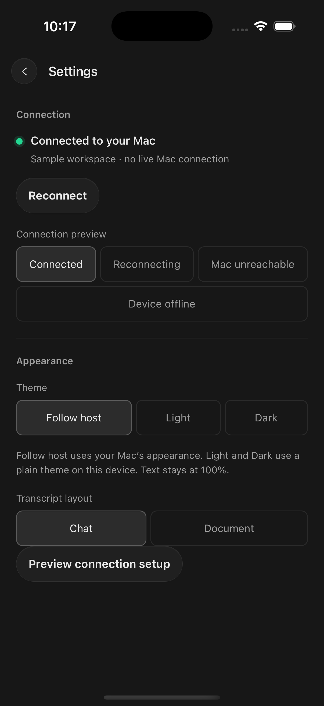
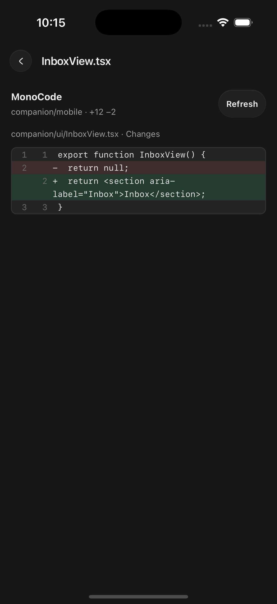

<p align="center">
  
</p>

<h1 align="center">MonoCode Mobile Companion</h1>

<p align="center"><strong>Continue your Mac coding-agent sessions from your iPhone.</strong></p>

An independent, experimental iPhone companion for [MonoCode](https://github.com/hardbeat920/monocode). Check an agent's progress, send a follow-up, answer questions and approval prompts, review file changes, or stop a turn while away from your desk. Your phone controls the **same sessions running on your Mac**. Agents, provider credentials, project files, and authoritative conversation history stay on the Mac.

This repository includes **MonoCode Dev**, the companion-enabled Mac app, and **MonoCode Companion**, the native iPhone app. The ordinary upstream MonoCode app cannot host this companion. This is not an official MonoCode mobile release.

**Integration status — October 19, 2026:** iPhone Companion **0.1.1 (1009)**
remains valid in the internal Owner TestFlight group. This source candidate is
based on MonoCode **0.16.0** and retains the companion bridge; it does not create,
sign, upload, or publish a new Mac or iPhone artifact.

## Quickstart

**Mac availability:** use the signed build and update channel assigned to your
testing cohort; verify the installed version before pairing. The current public
updater is beta.8, while beta.9 is an internal baseline pending release review.
**iPhone access:** use your existing TestFlight invitation. Contributors can
[build from source](companion/README.md#build-requirements).

1. **Install MonoCode Dev on your Mac.** Download the `.dmg` above, open it, and drag **MonoCode Dev** into Applications. Use this mobile-enabled build; regular MonoCode cannot connect to the phone app.
2. **Open a project and start a chat.** Use your existing project folder and [provider login](docs/providers.md). Switching from regular MonoCode? See below.
3. **Show the pairing code.** On the Mac, go to **Settings → Connections → Phone companion**, turn on **Remote access**, and select **Show QR code**.
4. **Connect your iPhone.** Install **MonoCode Companion** through your TestFlight invitation, select **Scan QR ticket**, scan the code, and tap **Connect to Mac**.
5. **Continue from your phone.** Open a session to message the agent, answer supported questions/approvals, or stop a turn. Keep the Mac awake and MonoCode Dev open; re-enable Remote access after restarting the Mac app.

## Switch from regular MonoCode

**MonoCode Dev is a separate app and profile.** Installing it keeps your original MonoCode data intact; it does not automatically bring over saved chats.

| What you want to keep | How to move |
| --- | --- |
| Project files and Git worktrees | Open the same folders in Dev. No new clone or file move is needed. |
| Provider accounts | Dev can reuse existing provider CLI installations/logins. Check provider and integration access; some may require signing in again. |
| Saved chats, groups, Monos, and settings | These need a profile transfer. The migration tool used for the owner's move is not included in this public repository yet. |

**To start fresh:** finish active work in regular MonoCode, pause its scheduled runs, then quit it. Open your project folders in Dev and start new chats. Your older conversations remain in the original app; avoid running both apps against the same work at once.

**To carry over saved history:** use a maintainer-assisted transfer until the migration tool is published. It requires both apps closed, fresh backups of both profiles, compatible schemas, and a check that an existing conversation resumes correctly afterward. The transfer replaces Dev's profile rather than merging histories, keeps schedules paused for verification, and preserves existing Dev phone pairing. Do not manually copy a live database or repeat the transfer during ordinary app updates.

[See the mobile interface](#screenshots) · [Troubleshooting](#updates-and-recovery) · [Developer setup](companion/README.md)

<details>
<summary><strong>Detailed setup, availability, usage, and technical notes</strong></summary>

## Availability

Status as of **October 19, 2026**:

| Component | Current status |
| --- | --- |
| iPhone | **0.1.1 (1009)** is valid and in the internal **Owner testing** TestFlight group. External beta access and a public invitation are not available yet. |
| Mac installer | The installed internal baseline is beta.10. The published updater remains beta.8; this source integration has not produced a replacement signed installer. |
| Source | Available here for contributors who can build and sign the apps themselves. A GitHub source archive is not an app installer. |
| Updates | Internal iPhone updates use TestFlight. The verified Mac beta feed is active; download updates in-app and choose Restart to update when work is idle. |
| Notifications | **Disabled in build 1004**, with notification settings hidden. Open the phone app to check activity; background alerts are not included. |

Build 1004 also adds full-page Settings with Connection first, an icon-only back button, and improved group/project collapsing in workspace navigation. Physical upgrade and reconnection validation for this build remains pending; earlier builds have been exercised on a real iPhone.

**For community testers:** the Mac download is ready; the iPhone public invitation still awaits external TestFlight review and setup. You do not need to join the maintainer's Apple developer team. [Pairing and test instructions](docs/companion/beta-review.md) · [Privacy](docs/companion/privacy.md).

## Install and connect

### Existing internal TestFlight testers

1. Install or update **MonoCode Companion** in Apple's TestFlight app using your existing internal invitation. Choose **0.1.1 (1009)** when available. Update over the existing app to preserve pairing.
2. Open your compatible **MonoCode Dev** installation on your own Mac. Install and sign in to at least one agent using [provider setup](docs/providers.md), then open a project and confirm a chat works on the Mac.
3. In the Mac app, open **Settings → Connections → Phone companion**, enable **Remote access**, and select **Show QR code**.
4. On the iPhone, select **Scan QR ticket**, allow camera access, scan the Mac's code, and tap **Connect to Mac**. Pasting a ticket is also supported. A ticket expires after five minutes and enrolls one new device.
5. Keep MonoCode Dev open and the Mac awake. Locking the Mac is compatible with use; putting it to sleep makes it unavailable. After restarting the Mac app, enable Remote access again. Your pairing remains saved.

Each tester uses their own Mac and provider accounts. No separate VPN app, manual router configuration, or hosted agent account is required for pairing. The phone app does not supply a shared Mac or provider subscription.

### Build from source

These instructions are for contributors. Normal TestFlight testers do not need Xcode, Rust, a terminal, or a USB cable.

Use a **Mac**, Git, **Node.js 22.12+** (or a newer supported Node LTS), npm, stable Rust installed through rustup, and full Xcode with its command-line tools and an iOS platform/runtime. Native development archives have been built with Xcode 26.4; release CI selects Xcode 26.3. Older Xcode compatibility is not established. The simulator commands below target Apple Silicon; an Intel companion build is not validated.

Follow [Tauri's prerequisite guide](https://v2.tauri.app/start/prerequisites/) to install Xcode, Rust, Node.js, and the iOS tooling. Launch Xcode once to finish setup and install its iOS platform before building.

Clone and install dependencies:

```sh
git clone https://github.com/foleykyle01/monocode-mobile.git
cd monocode-mobile
npm ci
```

Upstream's separate experimental Expo client remains in
[`mobile/`](mobile/README.md). Its QUIC access path is independently configured
and defaults off; it does not replace this companion's established pairing or
transport protocol.

Build the companion-enabled Mac app:

```sh
npm run companion:desktop
open "target/release/bundle/macos/MonoCode Dev.app"
```

Use `npm run tauri:companion` instead for local desktop development. The ordinary `npm run tauri dev` command does not select the companion configuration and feature. Source builds are local development apps, not the signed/notarized release installer.

MonoCode Dev has a separate app identity and data directory from upstream MonoCode. It does not automatically import your existing projects or conversations. Open your project folders in Dev and create sessions there. Provider CLI binaries and existing logins can still be shared with your daily installation; separate app data does not sandbox agent access to files. MonoCode-managed provider updates and the upstream app update feed are disabled in this configuration.

For a connected iPhone Simulator build:

```sh
rustup target add aarch64-apple-ios aarch64-apple-ios-sim
npm run companion:ios -- init --ci --skip-targets-install
npm run companion:ios -- build --debug --target aarch64-sim --no-sign
open -a Simulator
```

Once an iPhone simulator is booted, install and launch the built app:

```sh
xcrun simctl install booted "companion/mobile/src-tauri/gen/apple/build/arm64-sim/MonoCode Companion.app"
xcrun simctl launch booted dev.monocode.companion
```

Use the paste-ticket option if scanning is unavailable in the simulator. Follow the same Mac pairing steps above.

For a **physical iPhone**, use your own Apple development team, a trusted device with Developer Mode enabled, and development signing/provisioning that permits the configured app identifier. The release team's credentials are not included. Set your team before generating the Xcode project:

```sh
export APPLE_DEVELOPMENT_TEAM=YOUR_TEAM_ID
rustup target add aarch64-apple-ios aarch64-apple-ios-sim
npm run companion:ios -- init --ci --skip-targets-install
npm run companion:ios
```

The wrapper builds the web UI, generates opaque app icons, and produces a signed debug archive; its output reports the archive path. Open the generated Xcode project under `companion/mobile/src-tauri/gen/apple/`, select your signing team and connected iPhone, and run the app. Resolve App ID/profile conflicts with your own signing configuration. A differently signed or identified development app is a separate installation; do not assume it preserves a TestFlight app's pairing.

Generated Xcode projects, signing files, archives, and app data stay outside Git. Repeat initialization after Tauri/iOS configuration changes. See the [developer guide](companion/README.md) for sample-mode simulator configuration and deeper implementation details.

### Preview without agents

After `npm ci`, build the native Mac preview of the phone UI:

```sh
npm run companion:preview
```

Open the generated **MonoCode Phone Preview.app** reported by the build. Its workspace, conversations, approvals, Inbox, and pairing flow use sample data and contact no agents. It is a UI preview, not a real connection to your Mac sessions.

## Use the companion

| Task | How it works |
| --- | --- |
| Find your work | Browse Monos and groups → projects → sessions. Expand a group/project to reach its chats; use workspace collapse controls to shorten the list. Initialize unopened Monos on the Mac first. |
| Continue a conversation | Open an existing session, read its transcript and tool activity, and send a follow-up. Create a blank session or select an advertised model/access mode where supported. |
| Unblock an agent | Answer supported structured questions, allow or deny a pending action, or stop a running turn. Truncated or unsupported prompts require the Mac. |
| Review changes | Open read-only Inbox items, workspace Git changes/diffs, Mono details, or a completed session's Changed files. Staging, committing, Keep, and Undo remain on the Mac. |
| Manage the phone | Open Settings for Connection and phone appearance. Appearance follows the Mac where supported; phone Light/Dark overrides do not change the Mac. Notification controls are absent in this release. |

Available actions depend on the Mac host and provider. Remote projects, habit runs, ephemeral/Inbox-ask sessions, orchestration-controlled sessions, and sessions undergoing removal/workspace changes are excluded. This is not full desktop feature parity.

**Historical Owner TestFlight 1006 — Mono project sessions and status:** when a Mono starts work in a project, its conversation shows a linked session card. Tap it to follow the live session, send messages, answer approvals, or Stop. Back preserves your Mono draft and reading position. Home cards reflect child Needs you/Working/Idle, with a Reduced Motion-aware working wheel. See the [1006 release record](docs/companion/release-1006.md). Current availability is stated above; do not infer a new signed Mac release from this historical record.

## Approach and stack

The current direction is a **native iPhone client plus a companion-enabled Mac app**, delivered through TestFlight and signed Mac releases. A PWA remains a possible future client; it would require a browser-compatible transport and credential-storage design. It is not the current installation path.

| Layer | Implementation |
| --- | --- |
| Phone interface | React 19 and TypeScript, built with Vite, inside a Tauri 2 iOS shell. Shared UI patterns/components retain the desktop experience. |
| Phone native layer | Rust handles Iroh networking, pairing identity, and pending-command records in Apple Keychain. |
| Transport | Iroh 1.3 supplies authenticated, encrypted direct connections with relay fallback across Wi-Fi/cellular. |
| Mac integration | An embedded Rust host forwards allowlisted requests through an authenticated loopback bridge to the existing desktop session owner. |
| Delivery | TestFlight for iPhone; Developer ID signing, notarization, and separately signed Tauri update artifacts for the Mac release path. |

The request path is **iPhone UI → native Iroh transport → embedded Mac host → authenticated loopback bridge → existing desktop session**. There is no second provider runtime or direct database writer on the phone. The optional `npm run companion:host` CLI is a diagnostic tool; normal pairing uses the host embedded in MonoCode Dev.

## Updates and recovery

On iPhone, use **TestFlight → MonoCode Companion → Update**. Keep the existing installation and pairing during ordinary updates. [TestFlight builds expire after 90 days](https://developer.apple.com/help/app-store-connect/test-a-beta-version/testflight-overview/) and require replacement builds; this is a beta channel, not permanent production distribution.

The public Mac updater currently serves beta.8. In **Settings → General**, use **Check for updates**, then **Download → Later or Restart to update** when a higher version is available and work is idle. Internal beta.9 is not a public-update claim. Restart checks block installation while sessions, approvals, questions, queued work, or terminals are active. Keep the signed DMG as a fallback and preserve existing data/pairing. See the [historical beta.5 checks and limits](docs/companion/release-mac-beta5.md).

| Problem | What to do |
| --- | --- |
| Mac unavailable | Confirm the Mac is awake, MonoCode Dev is open, and Remote access is enabled. Re-enable it after each Mac app launch. Return to the phone app to refresh the connection. |
| Ticket expired or already used | Generate a fresh invitation on the Mac and scan/paste it promptly. Regenerating or cancelling an invitation invalidates the previous ticket. |
| Command timed out | Check the conversation before retrying. A timeout can mean the action ran but its receipt was lost. Review the unconfirmed command and explicitly retry the same request when appropriate. |
| Feature unavailable | Check the compatible Mac/phone versions and whether that session type supports the action. Review unsupported or truncated prompts on the Mac. |
| Remove a phone | Revoke it in the Mac's Phone companion settings. **Forget Mac** removes credentials on the phone only; it does not revoke the Mac's device record. |

The phone refreshes bounded snapshots while visible and reconnects after foregrounding or regained connectivity. It does not provide event replay or automatically resend uncertain commands. Command deduplication is bounded and memory-only on the Mac; after a host restart, an uncertain outcome can require manual review.

## Security and current limits

Pairing invitations are temporary enrollment credentials: do not share active QR codes or tickets publicly. A paired phone can instruct agents and select the access modes the Mac advertises, including full access. Agent permissions on the Mac remain the authority boundary.

Phone identity and pending commands use Keychain with synchronization disabled and `WhenUnlockedThisDeviceOnly` protection. Native code retains the identity; the host and bridge allowlist companion actions. Relay infrastructure carries encrypted traffic but can observe connection metadata and has its own availability/rate limits. There is no separate biometric app lock or independent security audit.

Same-session messaging over cellular and after locking/reopening the phone has been verified on earlier physical builds; Allow/Deny and Stop were also tested on device. Build 1009 is valid in Owner testing. Broader accessibility, keyboard/safe-area, long suspension, and network-handoff testing remains needed. Notifications, event replay, public external TestFlight access, automatic Mac feed delivery, and Android support are not included in the current release. Only an explicitly published signed Mac installer should be treated as downloadable.

</details>

## Screenshots

Captured October 14, 2026, these unedited iPhone Simulator screenshots show the current mobile design using a sample workspace on iOS 18.6. Settings and pairing include sample-mode preview controls. No live conversations, provider accounts, or pairing tickets are shown.

<table>
  <tr><th>Workspace and Monos</th><th>Chat and approvals</th></tr>
  <tr>
    <td></td>
    <td></td>
  </tr>
  <tr><th>Settings and connection</th><th>QR pairing setup</th></tr>
  <tr>
    <td></td>
    <td></td>
  </tr>
  <tr><th>Read-only Inbox</th><th>Read-only file diff</th></tr>
  <tr>
    <td></td>
    <td></td>
  </tr>
</table>

Mac connection settings and QR pairing below have opaque masks over the invitation and device ID; all other pixels are unchanged.


## Development and documentation

Use `npm run companion:build` to type-check and build the phone UI, and `npm run companion:test` for the companion bridge model, UI, and protocol suites. The [Companion CI workflow](.github/workflows/companion.yml) also checks the desktop integration, native mobile shell, and distribution guardrails. A passing source test suite does not replace physical device or signing validation.

- [Developer setup, preview, pairing, and protocol limits](companion/README.md)
- [Provider installation and login](docs/providers.md)
- [Validation scope and device evidence](docs/companion/validation-public.md)
- [Distribution plan](docs/companion/updates-and-distribution.md) and [maintainer release setup](docs/companion/release-setup.md)
- [Companion documentation index](docs/companion/README.md) and [contributing](CONTRIBUTING.md)

Report companion issues in [this repository](https://github.com/foleykyle01/monocode-mobile/issues). Include the phone build, Mac version, connection state, and reproduction steps; redact tickets, device identifiers, credentials, and private transcript content.

## Upstream and license

Derived from [MonoCode](https://github.com/hardbeat920/monocode), retaining its [MIT license](LICENSE) and [third-party notices](NOTICE). The desktop base is 0.13.0. Upstream desktop downloads and general platform documentation apply to the upstream app; those binaries do not include this companion host. Research from Superset informed design exploration; no Superset source is included in this repository.
